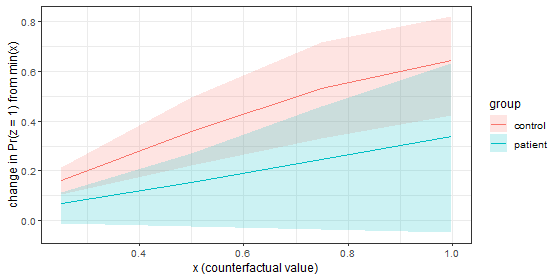

> Precomputed with CmdStan; source: `vignettes/contrasts.Rmd.orig`.

A fitted model answers many questions; a *contrast* picks one. stanworkflow
computes contrasts from posterior draws, one value per draw, so every summary
(median, interval, probability of direction, joint sign probabilities) comes
with its full posterior uncertainty. This vignette is about *which* quantity a
contrast measures, and when two routes that look different give the same
number.


``` r
library(stanworkflow)
library(dplyr)
#> Warning: package 'dplyr' was built under R version 4.5.3
```

## Three routes

`infer_contrasts(draws_method = )` offers three routes:

| Route | What is compared | Cost |
|---|---|---|
| `"descriptive"` | posterior predictions for the observed rows, grouped by the contrast variable (e.g. patients' rows vs controls' rows) | none; reuses stored draws |
| `"counterfactual"` | predictions for **all** rows with the contrast variable *set* to one value vs another, averaged over rows | one `generate_quantities()` run per grid point |
| `"parameter"` | a model parameter (e.g. a slope), optionally times a change `delta` in the predictor | none |

The counterfactual route is an *average predictive comparison*
[@gelman2007apc]: hold every other input at its observed value, change one
input, average the change in the prediction over the data. It is what
`marginaleffects::avg_comparisons()` computes for formula models
[@arelbundock2024marginaleffects], and what @gelman2020ros (ch. 14) recommend
for interpreting models with interactions or non-linear links. The parameter
route reads a coefficient, which is the same thing only in special cases.

## Data and model

Patients and controls from three sites; the outcome rises with a covariate
`x`, with a slope that differs by group and site. Patients have higher `x`
on average, and the sites contribute very different numbers of patients.


``` r
set.seed(11)
n <- c(control.A = 40, control.B = 40, control.C = 40,
       patient.A = 60, patient.B = 30, patient.C = 10)
cell <- rep(names(n), n)
d <- data.frame(group = factor(sub("\\..*", "", cell)),
                site  = factor(sub(".*\\.", "", cell)))
d$x <- ifelse(d$group == "control", runif(nrow(d), 0, 1), runif(nrow(d), 0.3, 1))
b_true <- c(control.A = 1, control.B = 1, control.C = 1,
            patient.A = 0.2, patient.B = 0.5, patient.C = 1)
d$y <- ifelse(d$group == "patient", -0.5, 0) + b_true[cell] * d$x + rnorm(nrow(d), sd = 0.5)
table(d$group, d$site)
#>          
#>            A  B  C
#>   control 40 40 40
#>   patient 60 30 10
```

The Stan model has a slope per group and site, `b[group, site]`. Its
generated quantities hold both the replicated outcome `y_rep` and its
expectation `mu_rep`.


``` r
code <- "
data {
  int<lower=1> N;
  int<lower=1> n_group;
  array[N] int<lower=1, upper=n_group> group_id;
  int<lower=1> n_site;
  array[N] int<lower=1, upper=n_site> site_id;
  vector[N] x;
  vector[N] y;
  int<lower=0, upper=1> skip_likelihood;
}
parameters {
  vector[n_group] a;
  matrix[n_group, n_site] b;
  real<lower=0> sigma;
}
transformed parameters {
  vector[N] mu;
  for (n in 1:N) mu[n] = a[group_id[n]] + b[group_id[n], site_id[n]] * x[n];
}
model {
  a ~ normal(0, 1);
  to_vector(b) ~ normal(0, 2);
  sigma ~ exponential(1);
  if (!skip_likelihood) y ~ normal(mu, sigma);
}
generated quantities {
  vector[N] mu_rep = mu;
  array[N] real y_rep = normal_rng(mu, sigma);
}
"
sp <- list(chains = 4, parallel_chains = 4, iter_warmup = 500, iter_sampling = 500,
           refresh = 0, show_messages = FALSE, seed = 1)
m <- stanmodel() |> compile_from_string(code)
m$sampler_params <- sampler_params(modifyList(sampler_params(), sp))
m <- fit(m, data = d)
```

## Descriptive, counterfactual and parameter contrasts of `group`


``` r
co_desc <- contrast("group", contrast_levels = c("control", "patient"))
co_cf   <- contrast("group", contrast_levels = c("control", "patient"),
                    outcome = outcome_spec(gq_var = "mu_rep"))
co_par  <- contrast("group", contrast_levels = c("control", "patient"),
                    parameter = "a", factors = "group")
r_desc <- infer_contrasts(m, co_desc, draws_method = "descriptive")
r_cf   <- infer_contrasts(m, co_cf,   draws_method = "counterfactual")
r_par  <- infer_contrasts(m, co_par,  draws_method = "parameter")
```


``` r
r_desc$summary
#> # A tibble: 1 × 8
#>   contrast_mean contrast_sd hpdi_lo hpdi_hi P_positive P_negative contrast_label
#>           <dbl>       <dbl>   <dbl>   <dbl>      <dbl>      <dbl> <chr>         
#> 1        -0.632      0.0943  -0.817  -0.449          0          1 patient - con…
#> # ℹ 1 more variable: prob <dbl>
r_cf$summary
#> # A tibble: 1 × 4
#>   contrast_label            mean     lo     hi
#>   <chr>                    <dbl>  <dbl>  <dbl>
#> 1 group=patient - control -0.670 -0.832 -0.511
r_par$summary
#> # A tibble: 1 × 8
#>   contrast_label    median hpdi_lo hpdi_hi    pd P_positive  prob scale    
#>   <chr>              <dbl>   <dbl>   <dbl> <dbl>      <dbl> <dbl> <chr>    
#> 1 patient - control -0.300  -0.677   0.100 0.933      0.067  0.95 parameter
```

Three different numbers, because there are three different questions:

- **descriptive**: how do the predicted outcomes of the patients we observed
  differ from those of the controls we observed? Patients also have higher `x`,
  so this mixes the group difference with the `x` difference.
- **counterfactual**: if every participant were a patient rather than a
  control, keeping their own `x` and site, how would the expected outcome
  change on average?
- **parameter** (`a[patient] - a[control]`): how do the groups differ *at
  `x = 0`*, a value no patient has.

None is wrong; the descriptive and parameter answers are just easy to read as
if they were the counterfactual one.

## Expectation, not replicate: `mu_rep` vs `y_rep`

A counterfactual contrast differences two predictions for the same draw. If
the prediction is `y_rep`, a fresh `normal_rng()` draw at every grid point, the
difference carries residual noise that has nothing to do with the contrast.
Probabilities of direction are then biased toward 0.5, two-way scenario
probabilities toward 0.25, and the answer depends on how far apart the grid
points are. stanworkflow warns:


``` r
co_2w <- function(gq_var) contrast("x", continuous = TRUE, two_way = "group",
                                   grouping_vars = "site",
                                   outcome = outcome_spec(gq_var = gq_var))
r_y  <- infer_contrasts(m, co_2w("y_rep"),  draws_method = "counterfactual", gq_steps = 4)
#> Warning: Counterfactual contrasts on 'y_rep' difference posterior predictive
#> draws, so each grid point adds fresh residual noise: sign probabilities are
#> biased toward 0.5 (two-way scenarios toward 0.25) and depend on the contrast
#> levels. Add an expectation (e.g. mu_rep) to generated quantities and use
#> `outcome_spec(gq_var = "mu_rep")`.
r_mu <- infer_contrasts(m, co_2w("mu_rep"), draws_method = "counterfactual", gq_steps = 4)
```

The probability that `x` raises the outcome in both groups, per site, at each
grid point of `x`:


``` r
bind_rows(y_rep = r_y$scenario_grid, mu_rep = r_mu$scenario_grid, .id = "gq_var") |>
  filter(scenario == "Affects both") |>
  mutate(x = round(contrast_var_value, 2)) |>
  select(gq_var, site, x, probability) |>
  tidyr::pivot_wider(names_from = x, names_prefix = "x = ", values_from = probability)
#> # A tibble: 6 × 5
#>   gq_var site  `x = 0.33` `x = 0.67` `x = 1`
#>   <chr>  <fct>      <dbl>      <dbl>   <dbl>
#> 1 y_rep  A          0.45       0.434   0.427
#> 2 y_rep  B          0.629      0.663   0.680
#> 3 y_rep  C          0.822      0.926   0.96 
#> 4 mu_rep A          0.421      0.421   0.421
#> 5 mu_rep B          0.702      0.702   0.702
#> 6 mu_rep C          0.972      0.972   0.972
```

With `mu_rep` the probability is the same at every grid point (the model is
linear in `x`, so only the size of the change differs, not its sign); with
`y_rep` it is off and drifts with the grid point, most in site C, where only
10 patients average out the noise. Always give the model an expectation in
generated quantities and use `outcome_spec(gq_var = "mu_rep")` for
counterfactual contrasts.

## The linear identity

For a model that is linear in `x` with an identity link, moving `x` by
$\Delta$ changes the expectation of row $n$ by exactly
$b_{g[n], s[n]} \Delta$. Averaging over the rows of group $g$ gives
$\sum_s (n_{gs} / n_g)\, b_{gs} \Delta$: the slope averaged over sites **with
data weights**, times $\Delta$. So the parameter route with `grouping_vars =
"group"` (keep group, average over site), `weights = "data"` and `delta =
"range"` (the span of the counterfactual grid) must reproduce the
counterfactual contrast draw by draw:


``` r
r_cfx <- infer_contrasts(m, contrast("x", continuous = TRUE, grouping_vars = "group",
                                     outcome = outcome_spec(gq_var = "mu_rep")),
                         draws_method = "counterfactual", gq_steps = 2)
par_x <- function(weights)
  infer_contrasts(m, contrast("x", continuous = TRUE, grouping_vars = "group",
                              parameter = "b", factors = c("group", "site"),
                              delta = "range", weights = weights),
                  draws_method = "parameter")
r_data  <- par_x("data")
r_equal <- par_x("equal")
```


``` r
j <- inner_join(r_cfx$grid_posterior, r_data$posterior, by = c(".draw", "group"),
                suffix = c("_cf", "_par"))
max(abs(j$contrast_cf - j$contrast_par))
#> [1] 3.913476e-08
r_data$scale
#> [1] "parameter × Δ(range of x), averaged over site (data weights)"
bind_rows(counterfactual = r_cfx$grid_summary |> select(group, median = mean, lo, hi),
          `parameter, data weights` = r_data$summary |> select(group, median, lo = hpdi_lo, hi = hpdi_hi),
          `parameter, equal weights` = r_equal$summary |> select(group, median, lo = hpdi_lo, hi = hpdi_hi),
          .id = "route")
#> # A tibble: 6 × 5
#>   route                    group   median     lo    hi
#>   <chr>                    <fct>    <dbl>  <dbl> <dbl>
#> 1 counterfactual           control 0.866   0.525 1.21 
#> 2 counterfactual           patient 0.0822 -0.408 0.570
#> 3 parameter, data weights  control 0.866   0.524 1.21 
#> 4 parameter, data weights  patient 0.0766 -0.411 0.564
#> 5 parameter, equal weights control 0.866   0.524 1.21 
#> 6 parameter, equal weights patient 0.257  -0.273 0.759
```

The difference is floating-point noise. Equal weights answer another question
(the average site, not the average patient) and differ here because the sites
are unbalanced among patients. When the identity holds, the parameter route is
the cheap way to the counterfactual answer: no `generate_quantities()` calls,
no grid, and it works on fits too large to sweep.

## Scaling the slope: `delta`

A slope is "per unit of `x`", and a unit may be tiny or huge. `delta`
multiplies the parameter by a meaningful change in the predictor, computed from
the data column `contrast_var`:

| `delta` | Change in `x` | Use |
|---|---|---|
| `NULL` | 1 unit (raw parameter) | when the unit is meaningful |
| `"range"` | max − min; the span of the default counterfactual grid | matching counterfactual results |
| `"q10q90"` | 90th − 10th percentile | a robust "low vs high" comparison |
| `"iqr"` | 75th − 25th percentile | typical within-sample variation |
| `"2sd"` | 2 standard deviations | comparable with a binary predictor [@gelman2008scaling] |
| a number | that change | a clinically chosen step |


``` r
deltas <- list("NULL" = NULL, "range" = "range", "q10q90" = "q10q90",
               "iqr" = "iqr", "2sd" = "2sd", "0.1" = 0.1)
r_delta <- lapply(deltas, function(dl)
  infer_contrasts(m, contrast("x", continuous = TRUE, grouping_vars = "group",
                              parameter = "b", factors = c("group", "site"),
                              weights = "data", delta = dl),
                  draws_method = "parameter"))
```


``` r
bind_rows(lapply(r_delta, function(r) r$summary |> select(group, median, hpdi_lo, hpdi_hi, scale)),
          .id = "delta")
#> # A tibble: 12 × 6
#>    delta  group    median hpdi_lo hpdi_hi scale                                 
#>    <chr>  <fct>     <dbl>   <dbl>   <dbl> <chr>                                 
#>  1 NULL   control 0.868    0.525   1.21   parameter, averaged over site (data w…
#>  2 NULL   patient 0.0768  -0.412   0.565  parameter, averaged over site (data w…
#>  3 range  control 0.866    0.524   1.21   parameter × Δ(range of x), averaged o…
#>  4 range  patient 0.0766  -0.411   0.564  parameter × Δ(range of x), averaged o…
#>  5 q10q90 control 0.597    0.361   0.834  parameter × Δ(q10–q90 of x), averaged…
#>  6 q10q90 patient 0.0528  -0.283   0.389  parameter × Δ(q10–q90 of x), averaged…
#>  7 iqr    control 0.339    0.205   0.474  parameter × Δ(IQR of x), averaged ove…
#>  8 iqr    patient 0.0300  -0.161   0.221  parameter × Δ(IQR of x), averaged ove…
#>  9 2sd    control 0.446    0.270   0.623  parameter × Δ(2 SD of x), averaged ov…
#> 10 2sd    patient 0.0394  -0.212   0.290  parameter × Δ(2 SD of x), averaged ov…
#> 11 0.1    control 0.0868   0.0525  0.121  parameter × 0.1, averaged over site (…
#> 12 0.1    patient 0.00768 -0.0412  0.0565 parameter × 0.1, averaged over site (…
```

Scaling by two standard deviations makes the slope of a continuous predictor
comparable with the coefficient of a binary one [@gelman2008scaling]; the
quantile-based versions are the robust alternatives.

## Non-linear models: where the routes part

The identity rests on two things: linearity in `x` and an identity link. Take a
logistic model for a binary outcome `z`,
$\Pr(z = 1) = \operatorname{logit}^{-1}(a_g + b_g x)$.


``` r
d$z <- rbinom(nrow(d), 1, plogis(ifelse(d$group == "control", -2 + 4 * d$x, -1 + 1.5 * d$x)))
code_logit <- "
data {
  int<lower=1> N;
  int<lower=1> n_group;
  array[N] int<lower=1, upper=n_group> group_id;
  vector[N] x;
  array[N] int<lower=0, upper=1> z;
  int<lower=0, upper=1> skip_likelihood;
}
parameters {
  vector[n_group] a;
  vector[n_group] b;
}
model {
  a ~ normal(0, 2);
  b ~ normal(0, 2);
  if (!skip_likelihood) z ~ bernoulli_logit(a[group_id] + b[group_id] .* x);
}
generated quantities {
  vector[N] p_rep = inv_logit(a[group_id] + b[group_id] .* x);
  array[N] int z_rep = bernoulli_logit_rng(a[group_id] + b[group_id] .* x);
}
"
ml <- stanmodel() |> compile_from_string(code_logit)
ml$sampler_params <- sampler_params(modifyList(sampler_params(), sp))
ml <- fit(ml, data = d, outcome_var = "z")
```


``` r
r_lpar <- infer_contrasts(ml, contrast("x", continuous = TRUE, parameter = "b",
                                       factors = "group", delta = "range", link = "logit"),
                          draws_method = "parameter")
#> draws_method = "parameter" reports effects on the linear-predictor (link) scale. For effects on the outcome scale use draws_method = "counterfactual" with an expectation GQ, e.g. outcome = outcome_spec(gq_var = "mu_rep").
#> This message is displayed once per session.
r_lcf  <- infer_contrasts(ml, contrast("x", continuous = TRUE, grouping_vars = "group",
                                       outcome = outcome_spec(gq_var = "p_rep")),
                          draws_method = "counterfactual", gq_steps = 5)
```

Declaring `link = "logit"` gives the one-time message above: the parameter
route reports link-scale effects.


``` r
r_lpar$summary |> select(group, median, hpdi_lo, hpdi_hi, scale)
#> # A tibble: 2 × 5
#>   group   median hpdi_lo hpdi_hi scale                    
#>   <fct>    <dbl>   <dbl>   <dbl> <chr>                    
#> 1 control   3.23   1.70     4.68 parameter × Δ(range of x)
#> 2 patient   1.54  -0.127    3.32 parameter × Δ(range of x)
r_lcf$grid_summary |> select(group, x = contrast_var_value, mean, lo, hi)
#> # A tibble: 8 × 5
#>   group       x   mean      lo    hi
#>   <fct>   <dbl>  <dbl>   <dbl> <dbl>
#> 1 control 0.250 0.162   0.106  0.215
#> 2 patient 0.250 0.0682 -0.0121 0.113
#> 3 control 0.499 0.359   0.220  0.497
#> 4 patient 0.499 0.153  -0.0242 0.268
#> 5 control 0.749 0.532   0.331  0.718
#> 6 patient 0.749 0.247  -0.0363 0.459
#> 7 control 0.998 0.645   0.424  0.821
#> 8 patient 0.998 0.339  -0.0483 0.634
```



For controls, the parameter route says that the log-odds rise by
3.2 across the range of `x`; the
counterfactual route says that the probability rises by
65
percentage points, for these participants. Their ratio is not constant: it depends on where on the logistic
curve each row sits, and the change accumulates unevenly across the grid. On a
non-linear model, the parameter answers a question on the link scale and the
counterfactual route is the one that answers it on the outcome scale
[@gelman2007apc; @mcelreath2020rethinking, ch. 10–11]. `vignette("mep")`
shows the same on a sigmoid recruitment curve, where the coil comparison on
the MEP grows several-fold with stimulation intensity.

## Two-way scenarios

`two_way` turns any of these contrasts into a joint statement: for each draw,
does the effect have the "positive" sign (`effect_positive`) in both levels of
the second factor, in one, or in neither? The output is a probability for each
of the four scenarios, which must be read against its prior baseline: with
independent symmetric priors each scenario has prior probability 0.25, and a
hierarchical prior that makes the two effects exchangeable puts more prior mass
on "affects both". The same contrast on a prior predictive fit
(`skip_likelihood = 1`, what `tune()` runs) gives that baseline.


``` r
co_s <- contrast("x", continuous = TRUE, two_way = "group",
                 parameter = "b", factors = c("group", "site"),
                 grouping_vars = "group", weights = "data")
m_prior <- fit(m, data = d, prior_predictive = TRUE)
r_2w    <- infer_contrasts(m,       co_s, draws_method = "parameter")
r_prior <- infer_contrasts(m_prior, co_s, draws_method = "parameter")
```


``` r
full_join(r_prior$scenario_grid, r_2w$scenario_grid, by = "scenario",
          suffix = c("_prior", "_posterior")) |>
  mutate(probability_posterior = coalesce(probability_posterior, 0))
#> # A tibble: 4 × 3
#>   scenario             probability_prior probability_posterior
#>   <chr>                            <dbl>                 <dbl>
#> 1 Affects control only             0.248                 0.379
#> 2 Affects both                     0.247                 0.621
#> 3 Affects neither                  0.256                 0    
#> 4 Affects patient only             0.248                 0
```

## References
