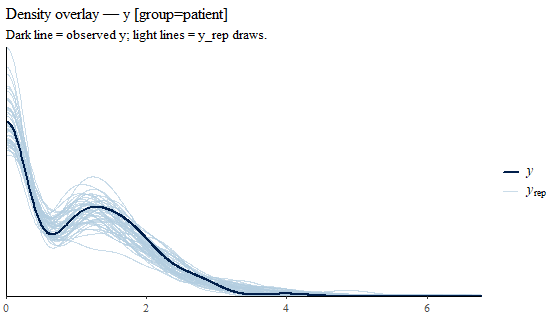

> Precomputed with CmdStan; source: `vignettes/hurdle.Rmd.orig`.

Some outcomes are zero for a reason of their own: a patient who cannot move a
finger at all produces an amplitude of exactly 0, not a small positive number.
A *hurdle* model has two parts: whether there is a response at all (the
*extensive* margin, $p$), and how large it is when there is one (the
*intensive* margin, $\mu$). Their product is the overall expected outcome (the
*marginal* mean, $p\mu$).

"Did the group differ?" then has three answers, one per margin. stanworkflow
does not ship a hurdle family; you write the model in Stan, expose the three
quantities in generated quantities under conventional names, and an
`outcome_spec` tells `infer_contrasts()` which one to use.

| Helper | Generated quantity | Meaning |
|---|---|---|
| `os_extensive()` | `p_respond` | $\Pr(y > 0)$ |
| `os_intensive()` | `mu_y` | $E[y \mid y > 0]$ |
| `os_marginal()` | `mu_marginal` | $E[y] = p \mu$ |
| `os_hurdle()` | all three | one call, three results |
| `outcome_spec(gq_var = )` | any | your own quantity |


``` r
library(stanworkflow)
```

## Simulated data

Patients respond less often as impairment `x` rises, and respond more weakly;
controls almost always respond.


``` r
set.seed(3)
n <- 150
d <- data.frame(group = factor(rep(c("control", "patient"), each = n)),
                x     = c(runif(n, 0, 0.3), runif(n, 0, 1)))
patient <- d$group == "patient"
p  <- plogis(ifelse(patient, 2.5 - 4 * d$x, 3))
mu <- exp(ifelse(patient, 0.8 - 0.8 * d$x, 1))
d$y <- ifelse(rbinom(2 * n, 1, p) == 1, rlnorm(2 * n, log(mu) - 0.4^2 / 2, 0.4), 0)
tapply(d$y == 0, d$group, mean)   # share of zeros
#>    control    patient 
#> 0.07333333 0.46000000
```

## The model

A logistic part for $p$ and a lognormal part for positive values,
parameterised so that `mu_y` is the mean, not the median, of the positive
values. `y_rep` combines both parts for predictive checks.


``` r
code <- "
data {
  int<lower=1> N;
  int<lower=1> n_group;
  array[N] int<lower=1, upper=n_group> group_id;
  vector[N] x;
  vector<lower=0>[N] y;
  int<lower=0, upper=1> skip_likelihood;
}
parameters {
  vector[n_group] a_p;
  vector[n_group] b_p;
  vector[n_group] a_mu;
  vector[n_group] b_mu;
  real<lower=0> sigma;
}
transformed parameters {
  vector[N] logit_p = a_p[group_id] + b_p[group_id] .* x;
  vector[N] log_mu  = a_mu[group_id] + b_mu[group_id] .* x;
}
model {
  a_p ~ normal(0, 2);  b_p ~ normal(0, 2);
  a_mu ~ normal(0, 1); b_mu ~ normal(0, 1);
  sigma ~ exponential(2);
  if (!skip_likelihood) {
    for (n in 1:N) {
      if (y[n] == 0) {
        target += bernoulli_logit_lpmf(0 | logit_p[n]);
      } else {
        target += bernoulli_logit_lpmf(1 | logit_p[n]) +
                  lognormal_lpdf(y[n] | log_mu[n] - square(sigma) / 2, sigma);
      }
    }
  }
}
generated quantities {
  vector[N] p_respond   = inv_logit(logit_p);
  vector[N] mu_y        = exp(log_mu);
  vector[N] mu_marginal = p_respond .* mu_y;
  vector[N] y_rep;
  for (n in 1:N)
    y_rep[n] = bernoulli_rng(p_respond[n]) ? lognormal_rng(log_mu[n] - square(sigma) / 2, sigma) : 0;
}
"
m <- stanmodel() |> compile_from_string(code)
m$sampler_params <- sampler_params(modifyList(sampler_params(), list(
  chains = 4, parallel_chains = 4, iter_warmup = 500, iter_sampling = 500,
  refresh = 0, show_messages = FALSE, seed = 1)))
m <- fit(m, data = d)
```

A posterior predictive check on `y_rep` should reproduce both the share of
zeros and the spread of positive values (`p_B_min` is 1 because the minimum is
0 in the data and in every replicate):


``` r
chk <- ppc(m, .by = "group")
```


``` r
chk$summary
#>      ...1 p_B_mean p_B_sd p_B_median p_B_mad p_B_min p_B_max   cov_50.
#> 1 control   0.3865 0.1405      0.599  0.7765       1   0.056 0.5466667
#> 2 patient   0.5015 0.6800      0.353  0.3500       1   0.580 0.7666667
#>     cov_90.
#> 1 0.9133333
#> 2 0.9600000
chk$group_results$patient$plots$density_overlay
```



## One contrast, three margins


``` r
r <- infer_contrasts(m, contrast("group", contrast_levels = c("control", "patient"),
                                 outcome = os_hurdle()),
                     draws_method = "counterfactual")
```


``` r
names(r)
#> [1] "marginal"  "extensive" "intensive" "contrast"
r$extensive$summary
#> # A tibble: 1 × 4
#>   contrast_label            mean     lo     hi
#>   <chr>                    <dbl>  <dbl>  <dbl>
#> 1 group=patient - control -0.256 -0.367 -0.120
r$intensive$summary
#> # A tibble: 1 × 4
#>   contrast_label           mean    lo     hi
#>   <chr>                   <dbl> <dbl>  <dbl>
#> 1 group=patient - control -1.06 -1.55 -0.674
r$marginal$summary
#> # A tibble: 1 × 4
#>   contrast_label           mean    lo     hi
#>   <chr>                   <dbl> <dbl>  <dbl>
#> 1 group=patient - control -1.33 -1.82 -0.899
```

Each contrast sets every participant's group to "patient" rather than
"control", keeps their own impairment `x`, and averages the change in the
expected outcome over participants. As patients they would respond less often
*and* more weakly; the marginal difference combines both. Reporting
only the marginal mean hides which part changed; reporting only the intensive
margin ignores the patients who did not respond at all. These are
counterfactual contrasts on expectations, so they need no `y_rep` (see
`vignette("contrasts")`).

## A continuous predictor, per margin

The effect of impairment `x` among patients, from no to full impairment,
on each margin:


``` r
rx <- infer_contrasts(m, contrast("x", continuous = TRUE, grouping_vars = "group",
                                  filter_draws = quote(group == "patient"),
                                  outcome = os_hurdle()),
                      draws_method = "counterfactual", gq_steps = 2)
```


``` r
lapply(rx[c("extensive", "intensive", "marginal")], function(z) z$grid_summary)
#> $extensive
#> # A tibble: 1 × 8
#>   contrast_var_value baseline_var_value group     mean     lo     hi P_positive
#>                <dbl>              <dbl> <fct>    <dbl>  <dbl>  <dbl>      <dbl>
#> 1              0.997            0.00257 patient -0.554 -0.724 -0.338          0
#> # ℹ 1 more variable: P_negative <dbl>
#> 
#> $intensive
#> # A tibble: 1 × 8
#>   contrast_var_value baseline_var_value group    mean    lo     hi P_positive
#>                <dbl>              <dbl> <fct>   <dbl> <dbl>  <dbl>      <dbl>
#> 1              0.997            0.00257 patient -1.19 -1.67 -0.717          0
#> # ℹ 1 more variable: P_negative <dbl>
#> 
#> $marginal
#> # A tibble: 1 × 8
#>   contrast_var_value baseline_var_value group    mean    lo    hi P_positive
#>                <dbl>              <dbl> <fct>   <dbl> <dbl> <dbl>      <dbl>
#> 1              0.997            0.00257 patient -1.47 -1.90 -1.05          0
#> # ℹ 1 more variable: P_negative <dbl>
```

## Your own quantity

Any generated quantity can be the outcome, e.g. the probability of a strong
response, $\Pr(y > 2)$, if the model adds it to generated quantities; and
`filter_fn` / `transform_fn` in `outcome_spec()` subset or transform the draws
before the contrast is taken:


``` r
outcome_spec(gq_var = "mu_y", transform_fn = log, label = "log E[y | y > 0]")
```
