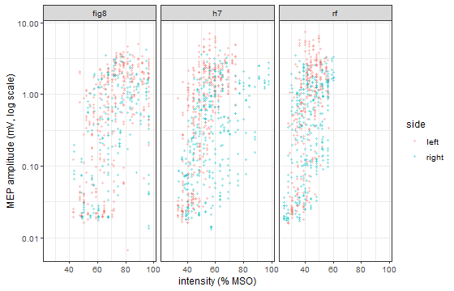
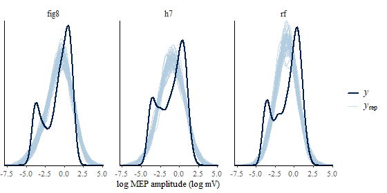
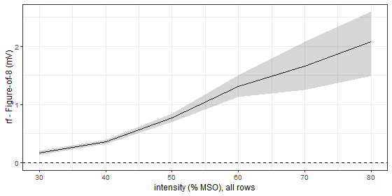

> Precomputed with CmdStan; source: `vignettes/mep.Rmd.orig`. The posterior
> fit takes several minutes, the counterfactual sweeps a few more.

Transcranial magnetic stimulation (TMS) of the motor cortex evokes a muscle
response, the motor evoked potential (MEP). Its amplitude grows with
stimulation intensity along a sigmoid *input-output curve*, described by a
threshold $\theta$ (intensity at half the maximal response), a slope $s$ and a
plateau $A$. @wondermanbarsela2026mep compared three TMS coils (Figure-of-8,
H7 and a multidirectional rotational-field array, "rf") in 10 healthy adults
with a hierarchical Bayesian sigmoid model. The data and the original model are
public (<https://github.com/ShayOfir/MEP_IOcurve>); the data ship with
stanworkflow as `mep_io`, and the model, renamed to stanworkflow's data
conventions, as `inst/stan/mep_sigmoid`.

The model is non-linear in intensity and its coil effects act on $\theta$,
$s$ and $\log A$, not on the MEP itself. It is the kind of model where reading
a parameter and asking a counterfactual question give different answers.


``` r
library(stanworkflow)
library(dplyr)
#> Warning: package 'dplyr' was built under R version 4.5.3
```

## Data


``` r
head(mep_io)
#>   subj coil side intensity         y
#> 1  S01   h7 left        49 1.6109375
#> 2  S01   h7 left        49 0.5319792
#> 3  S01   h7 left        49 0.7720833
#> 4  S01   h7 left        49 1.3413542
#> 5  S01   h7 left        49 0.4986458
#> 6  S01   h7 left        45 1.7218750
table(mep_io$coil, mep_io$side)
#>       
#>        left right
#>   fig8  335   217
#>   h7    352   347
#>   rf    312   318
mep_io |> group_by(coil) |> summarise(min = min(intensity), max = max(intensity))
#> # A tibble: 3 × 3
#>   coil    min   max
#>   <fct> <dbl> <dbl>
#> 1 fig8   42.5  96.5
#> 2 h7     33    98  
#> 3 rf     25    60
```

`intensity` is in % of maximal stimulator output (MSO). Each coil was used
from about 90% to 150% of each subject's resting motor threshold, which for
the rf coil is far lower than for the others.



## Model

$$
\begin{aligned}
y_n &\sim \operatorname{LogNormal}(\log \mu_n, \sigma), \qquad
\mu_n = \frac{A_{ijk}}{1 + \exp\{-s_{ijk}(I_n - \theta_{ijk})\}} \\
\phi_{ijk} &= \beta_\phi + \delta^{\text{coil}}_{\phi,j} + \delta^{\text{side}}_{\phi,k} + \tau_\phi z_{\phi,i},
\qquad \phi \in \{\theta, s, \log A\}
\end{aligned}
$$

for subject $i$, coil $j$, side $k$, with sum-to-zero coil and side effects and
non-centred subject effects. Observations above a coil's maximal output cannot
exist (missing not at random); the likelihood is restricted to the attainable
range. The Stan code follows stanworkflow's naming convention (`subj_id`,
`coil_id`, `side_id`, `intensity`, `y`, `prior_*`, `skip_likelihood`); its
generated quantities hold the curve `mu_rep` (the median MEP) and `y_rep`.


``` r
models <- file.path(tempdir(), "models")
dir.create(models, showWarnings = FALSE)
file.copy(system.file("stan", "mep_sigmoid", package = "stanworkflow"), models,
          recursive = TRUE)
#> [1] TRUE
cat(readLines(file.path(models, "mep_sigmoid", "model_code.stan")), sep = "\n")
#> // Hierarchical sigmoid MEP input-output curve (IOcurve9 of ShayOfir/MEP_IOcurve,
#> // Wonderman Bar Sela et al. 2026), renamed to stanworkflow's data conventions.
#> // curve: mu = A / (1 + exp(-slope * (intensity - theta))), y ~ lognormal(log(mu), sigma)
#> // theta, slope, log(A) = population mean + coil effect + side effect + subject effect.
#> data {
#>   int<lower=1> N;
#>   int<lower=1> n_subj;
#>   array[N] int<lower=1, upper=n_subj> subj_id;
#>   int<lower=1> n_coil;
#>   array[N] int<lower=1, upper=n_coil> coil_id;
#>   int<lower=1> n_side;
#>   array[N] int<lower=1, upper=n_side> side_id;
#>   vector[N] intensity;
#>   vector<lower=0>[N] y;
#>   vector[n_coil] mso_limit;
#>   real prior_mu_theta_mean;
#>   real prior_mu_theta_sd;
#>   real prior_mu_slope_mean;
#>   real prior_mu_slope_sd;
#>   real prior_mu_A_mean;
#>   real prior_mu_A_sd;
#>   real prior_sigma_theta_scale;
#>   real prior_sigma_slope_scale;
#>   real prior_sigma_A_scale;
#>   real prior_sigma_scale;
#>   real prior_delta_theta_coil_scale;
#>   real prior_delta_theta_side_scale;
#>   real prior_delta_slope_coil_scale;
#>   real prior_delta_slope_side_scale;
#>   real prior_delta_logA_coil_scale;
#>   real prior_delta_logA_side_scale;
#>   int<lower=0, upper=1> skip_likelihood;
#> }
#> transformed data {
#>   real sigma_ubound = 2;
#>   real logA_cap = 2;
#> }
#> parameters {
#>   vector[n_subj] theta_z;
#>   vector[n_subj] slope_z;
#>   vector[n_subj] logA_z;
#>   real mu_theta;
#>   real mu_slope;
#>   real mu_logA;
#>   real<lower=0, upper=sigma_ubound> sigma_theta;
#>   real<lower=0, upper=sigma_ubound> sigma_slope;
#>   real<lower=0, upper=sigma_ubound> sigma_logA;
#>   real<lower=0, upper=sigma_ubound> sigma;
#>   vector[n_coil] delta_theta_coil_raw;
#>   vector[n_side] delta_theta_side_raw;
#>   vector[n_coil] delta_slope_coil_raw;
#>   vector[n_side] delta_slope_side_raw;
#>   vector[n_coil] delta_logA_coil_raw;
#>   vector[n_side] delta_logA_side_raw;
#> }
#> transformed parameters {
#>   // sum-to-zero coil and side effects
#>   vector[n_coil] delta_theta_coil = delta_theta_coil_raw - mean(delta_theta_coil_raw);
#>   vector[n_side] delta_theta_side = delta_theta_side_raw - mean(delta_theta_side_raw);
#>   vector[n_coil] delta_slope_coil = delta_slope_coil_raw - mean(delta_slope_coil_raw);
#>   vector[n_side] delta_slope_side = delta_slope_side_raw - mean(delta_slope_side_raw);
#>   vector[n_coil] delta_logA_coil = delta_logA_coil_raw - mean(delta_logA_coil_raw);
#>   vector[n_side] delta_logA_side = delta_logA_side_raw - mean(delta_logA_side_raw);
#>   // curve parameters per subject x coil x side
#>   array[n_subj, n_coil, n_side] real theta;
#>   array[n_subj, n_coil, n_side] real slope;
#>   array[n_subj, n_coil, n_side] real logA;
#>   for (i in 1:n_subj) for (j in 1:n_coil) for (k in 1:n_side) {
#>     theta[i, j, k] = mu_theta + delta_theta_coil[j] + delta_theta_side[k] + sigma_theta * theta_z[i];
#>     slope[i, j, k] = mu_slope + delta_slope_coil[j] + delta_slope_side[k] + sigma_slope * slope_z[i];
#>     logA[i, j, k]  = mu_logA  + delta_logA_coil[j]  + delta_logA_side[k]  + sigma_logA  * logA_z[i];
#>   }
#> }
#> model {
#>   mu_theta ~ normal(prior_mu_theta_mean, prior_mu_theta_sd);
#>   mu_slope ~ normal(prior_mu_slope_mean, prior_mu_slope_sd);
#>   mu_logA  ~ normal(log(prior_mu_A_mean), prior_mu_A_sd);
#>   sigma_theta ~ student_t(3, 0, prior_sigma_theta_scale);
#>   sigma_slope ~ student_t(3, 0, prior_sigma_slope_scale);
#>   sigma_logA  ~ student_t(3, 0, prior_sigma_A_scale);
#>   sigma       ~ student_t(3, 0, prior_sigma_scale);
#>   theta_z ~ std_normal();
#>   slope_z ~ std_normal();
#>   logA_z  ~ std_normal();
#>   delta_theta_coil_raw ~ normal(0, prior_delta_theta_coil_scale);
#>   delta_theta_side_raw ~ normal(0, prior_delta_theta_side_scale);
#>   delta_slope_coil_raw ~ normal(0, prior_delta_slope_coil_scale);
#>   delta_slope_side_raw ~ normal(0, prior_delta_slope_side_scale);
#>   delta_logA_coil_raw  ~ normal(0, prior_delta_logA_coil_scale);
#>   delta_logA_side_raw  ~ normal(0, prior_delta_logA_side_scale);
#>   if (!skip_likelihood) {
#>     for (n in 1:N) {
#>       // MNAR: intensities above a coil's maximal output cannot be observed
#>       if (intensity[n] <= mso_limit[coil_id[n]]) {
#>         int i = subj_id[n]; int j = coil_id[n]; int k = side_id[n];
#>         real mu = exp(fmin(logA[i, j, k], logA_cap)) /
#>                   (1 + exp(-slope[i, j, k] * (intensity[n] - theta[i, j, k])));
#>         y[n] ~ lognormal(log(mu + 1e-9), sigma);
#>       }
#>     }
#>   }
#> }
#> generated quantities {
#>   // mu_rep: the curve (median MEP; the mean is exp(sigma^2 / 2) times larger)
#>   vector[N] mu_rep;
#>   vector[N] y_rep;
#>   for (n in 1:N) {
#>     int i = subj_id[n]; int j = coil_id[n]; int k = side_id[n];
#>     mu_rep[n] = exp(fmin(logA[i, j, k], logA_cap)) /
#>                 (1 + exp(-slope[i, j, k] * (intensity[n] - theta[i, j, k])));
#>     y_rep[n] = lognormal_rng(log(mu_rep[n] + 1e-9), sigma);
#>   }
#> }
read.csv(file.path(models, "mep_sigmoid", "priors.csv"))
#>                           prior value
#> 1           prior_mu_theta_mean 50.00
#> 2             prior_mu_theta_sd 10.00
#> 3           prior_mu_slope_mean  0.15
#> 4             prior_mu_slope_sd  0.05
#> 5               prior_mu_A_mean  1.00
#> 6                 prior_mu_A_sd  0.20
#> 7       prior_sigma_theta_scale  1.00
#> 8       prior_sigma_slope_scale  0.03
#> 9           prior_sigma_A_scale  0.30
#> 10            prior_sigma_scale  0.30
#> 11 prior_delta_theta_coil_scale  0.30
#> 12 prior_delta_theta_side_scale  0.30
#> 13 prior_delta_slope_coil_scale  0.30
#> 14 prior_delta_slope_side_scale  0.30
#> 15  prior_delta_logA_coil_scale  0.10
#> 16  prior_delta_logA_side_scale  0.10
```

The maximal output of each coil (`mso_limit`, not a data column) goes in
`extra`:


``` r
reg <- regimen(
  "mep_sigmoid",
  data_list     = list(data  = mep_io,
                       extra = list(mso_limit = c(fig8 = 1670, h7 = 1700, rf = 1700) / 17)),
  models_folder = models,
  results_path  = file.path(tempdir(), "results_mep"),
  ppc_by        = "coil",
  prior_sampler_params = list(chains = 4, parallel_chains = 4, iter_warmup = 250,
                              iter_sampling = 250, refresh = 0, show_messages = FALSE),
  post_sampler_params  = list(chains = 4, parallel_chains = 4, iter_warmup = 500,
                              iter_sampling = 500, adapt_delta = 0.95,
                              max_treedepth = 12, refresh = 0, show_messages = FALSE,
                              seed = 2026)
)
```


``` r
t_fit <- system.time(reg <- run(reg, steps = c("prepare", "tune", "fit")))
```

`run()` draws the prior and posterior predictive checks per coil (hidden here:
on the raw mV scale the lognormal tails squash the densities). The three steps
took 22 minutes; the diagnostics:


``` r
fit <- reg$wf$post_fit
fit$fitted_model$diagnostic_summary()
#> $num_divergent
#> [1] 0 0 0 0
#> 
#> $num_max_treedepth
#> [1] 0 0 0 0
#> 
#> $ebfmi
#> [1] 0.8319647 0.8821046 0.7982089 0.8863024
reg$wf$diagnostics |>
  filter(grepl("^(mu_|sigma|delta_.*_coil)", variable)) |>
  select(variable, median, q5, q95, rhat, ess_bulk)
#> # A tibble: 1,906 × 6
#>    variable                 median      q5     q95  rhat ess_bulk
#>    <chr>                     <dbl>   <dbl>   <dbl> <dbl>    <dbl>
#>  1 mu_theta                67.3    65.2    69.5     1.00    1164.
#>  2 mu_slope                 0.148   0.128   0.169   1.01     631.
#>  3 mu_logA                  0.388   0.0815  0.664   1.00     584.
#>  4 sigma_theta              1.94    1.74    2.00    1.00    2025.
#>  5 sigma_slope              0.0308  0.0214  0.0472  1.00     774.
#>  6 sigma_logA               0.734   0.497   1.18    1.00     626.
#>  7 sigma                    1.16    1.13    1.20    1.00    3340.
#>  8 delta_theta_coil_raw[1]  0.639   0.142   1.13    1.00    3018.
#>  9 delta_theta_coil_raw[2] -0.0625 -0.548   0.410   1.00    2651.
#> 10 delta_theta_coil_raw[3] -0.577  -1.04   -0.109   1.00    3397.
#> # ℹ 1,896 more rows
reg$wf$posterior_ppc_results$y$summary
#>   ...1 p_B_mean p_B_sd p_B_median p_B_mad p_B_min p_B_max   cov_50.   cov_90.
#> 1   h7   0.9960 1.0000      0.000       0   0.000       1 0.5464950 0.9113019
#> 2   rf   0.1025 0.9945      0.000       0   0.000       1 0.4079365 0.9158730
#> 3 fig8   1.0000 1.0000      0.008       0   0.007       1 0.5706522 0.8949275
```

The port reproduces the published fit (e.g. population threshold
$\beta_\theta \approx 67$ % MSO and residual $\sigma \approx 1.16$ in both).
The predictive check flags what a residual SD of 1.16 on the log scale means:
replicated medians and robust spreads are off ($p_B$ near 0 or 1), although
the 50% and 90% intervals cover about the nominal share of observations. This
vignette demonstrates the workflow and the contrasts, not a re-analysis. The
stored draws work with any bayesplot function, e.g. the posterior predictive
check on the log scale:


``` r
yrep <- posterior::as_draws_matrix(posterior::subset_draws(fit$draws, "y_rep"))
bayesplot::ppc_dens_overlay_grouped(log(mep_io$y), log(yrep[1:50, ]), group = mep_io$coil) +
  ggplot2::labs(x = "log MEP amplitude (log mV)")
```



The observed log amplitudes are bimodal: a cluster near 0.02 mV (no response
above the recording noise floor) and the recruited responses. A single
lognormal cannot reproduce both, which is what the $p_B$ values above flag; a
hurdle or mixture likelihood (`vignette("hurdle")`) would be the next model
to try.


## Parameter route: what the coils do to the curve

The coil effects are parameters of the curve. Differences between coils, draw
by draw, for each curve parameter:


``` r
par_coil <- function(p, link = "identity")
  infer_contrasts(fit, contrast("coil", parameter = p, factors = "coil", link = link),
                  draws_method = "parameter")
r_theta <- par_coil("delta_theta_coil")
r_slope <- par_coil("delta_slope_coil")
r_logA  <- par_coil("delta_logA_coil", link = "log")
#> draws_method = "parameter" reports effects on the linear-predictor (link) scale. For effects on the outcome scale use draws_method = "counterfactual" with an expectation GQ, e.g. outcome = outcome_spec(gq_var = "mu_rep").
#> This message is displayed once per session.
```


``` r
bind_rows(theta = r_theta$summary, slope = r_slope$summary, logA = r_logA$summary,
          .id = "parameter") |>
  select(parameter, contrast_label, median, hpdi_lo, hpdi_hi, pd)
#> # A tibble: 9 × 6
#>   parameter contrast_label  median hpdi_lo hpdi_hi    pd
#>   <chr>     <chr>            <dbl>   <dbl>   <dbl> <dbl>
#> 1 theta     h7 - fig8      -0.697  -1.58    0.0372 0.96 
#> 2 theta     rf - fig8      -1.22   -2.03   -0.378  0.998
#> 3 theta     rf - h7        -0.513  -1.35    0.236  0.895
#> 4 slope     h7 - fig8      -0.0818 -0.107  -0.0590 1    
#> 5 slope     rf - fig8      -0.116  -0.138  -0.0943 1    
#> 6 slope     rf - h7        -0.0341 -0.0449 -0.0241 1    
#> 7 logA      h7 - fig8       0.769   0.613   0.938  1    
#> 8 logA      rf - fig8       1.15    0.957   1.35   1    
#> 9 logA      rf - h7         0.379   0.184   0.589  1
```

The coils differ little in threshold (rf − Figure-of-8:
-1.2 % MSO; the priors allow the coil
effects on $\theta$ only a few tenths of a percent), and clearly in slope (rf
shallower) and plateau (rf higher by a factor of about
3.2; `delta_logA_coil` is on the log scale, declared with
`link = "log"`, hence the message). The per-subject curves `theta[subj, coil, side]` give a
mean threshold per coil, averaged over subjects and sides with data weights
(`grouping_vars = "coil"`, `weights = "data"`; the missing S01 Figure-of-8
right curve gets weight 0):


``` r
r_theta_avg <- infer_contrasts(fit, contrast("coil", grouping_vars = "coil",
                                             weights = "data", parameter = "theta",
                                             factors = c("subj", "coil", "side")),
                               draws_method = "parameter")
```


``` r
r_theta_avg$level_summary
#> # A tibble: 3 × 7
#>   coil  median hpdi_lo hpdi_hi    pd P_positive scale                           
#>   <fct>  <dbl>   <dbl>   <dbl> <dbl>      <dbl> <chr>                           
#> 1 fig8    67.8    65.7    70.2     1          1 parameter, averaged over subj ×…
#> 2 h7      67.3    64.8    69.6     1          1 parameter, averaged over subj ×…
#> 3 rf      66.7    64.1    69.0     1          1 parameter, averaged over subj ×…
r_theta_avg$scale
#> [1] "parameter, averaged over subj × side (data weights)"
```

These are statements about the *curve*: where it rises, how steeply, how high
it ends. They do not say how large the MEP is at a given intensity.

## Counterfactual route: what the coils do to the MEP

"How would the MEP change if the same stimulation were delivered with another
coil?" is a counterfactual question on the outcome scale. For every observed
row, set the coil, keep subject, side and intensity, compute the expected
curve `mu_rep`, and average the difference over rows:


``` r
co_coil <- function(levels) contrast("coil", contrast_levels = levels,
                                     outcome = outcome_spec(gq_var = "mu_rep"))
r_cf <- infer_contrasts(fit, list(co_coil(c("fig8", "rf")), co_coil(c("h7", "rf")),
                                  co_coil(c("fig8", "h7"))),
                        draws_method = "counterfactual", gq_n_draws = 1000)
```


``` r
bind_rows(lapply(r_cf, `[[`, "summary"))
#> # A tibble: 3 × 4
#>   contrast_label  mean    lo    hi
#>   <chr>          <dbl> <dbl> <dbl>
#> 1 coil=rf - fig8 0.960 0.809 1.11 
#> 2 coil=rf - h7   0.457 0.308 0.632
#> 3 coil=h7 - fig8 0.503 0.416 0.596
```

The answer depends on where the comparison is made. Evaluating the same
contrast with every row's intensity set to a fixed value shows how the coil
difference changes along the intensity axis:


``` r
intensities <- c(30, 40, 50, 60, 70, 80)
r_int <- lapply(intensities, function(i)
  infer_contrasts(fit, co_coil(c("fig8", "rf")),
                  data = mutate(mep_io, intensity = i),
                  draws_method = "counterfactual", gq_n_draws = 1000)$summary)
```


``` r
bind_rows(r_int) |> mutate(intensity = intensities, .before = 1)
#> # A tibble: 6 × 5
#>   intensity contrast_label  mean    lo    hi
#>       <dbl> <chr>          <dbl> <dbl> <dbl>
#> 1        30 coil=rf - fig8 0.165 0.136 0.200
#> 2        40 coil=rf - fig8 0.361 0.327 0.399
#> 3        50 coil=rf - fig8 0.767 0.692 0.846
#> 4        60 coil=rf - fig8 1.32  1.13  1.50 
#> 5        70 coil=rf - fig8 1.66  1.25  2.07 
#> 6        80 coil=rf - fig8 2.08  1.49  2.59
```



## Parameter vs counterfactual

Which coil evokes the larger MEP at a given intensity? None of the three
parameter contrasts answers that on its own: a shallower slope lowers the
curve below its midpoint, a higher plateau raises it everywhere, and how the
two combine depends on the intensity. The parameter route says "almost the
same threshold, shallower, higher"; the counterfactual route says "rf evokes
MEPs larger by
0.17 mV at 30 % MSO and by
2.08 mV at 80 % MSO".
The averaged counterfactual contrast above (0.96
mV) is one point on that curve, weighted by the intensities that happened to
be tested. On a linear model with an identity link the routes coincide
(`vignette("contrasts")`); on a sigmoid they answer different questions, and
the counterfactual one is usually the question asked.

The same holds for intensity itself. In a linear model the effect of raising
intensity by $\Delta$ is slope $\times\,\Delta$ wherever it is applied
(`vignette("contrasts")`); on a sigmoid it is not. The counterfactual route
sweeps intensity over its observed range, per coil:


``` r
r_sweep <- infer_contrasts(fit, contrast("intensity", continuous = TRUE,
                                         grouping_vars = "coil",
                                         outcome = outcome_spec(gq_var = "mu_rep")),
                           draws_method = "counterfactual", gq_steps = 6,
                           gq_n_draws = 1000)
```


``` r
r_sweep$grid_summary |> select(coil, intensity = contrast_var_value, mean, lo, hi)
#> # A tibble: 15 × 5
#>    coil  intensity    mean      lo      hi
#>    <fct>     <dbl>   <dbl>   <dbl>   <dbl>
#>  1 h7         39.6 0.0854  0.0752  0.0965 
#>  2 rf         39.6 0.245   0.224   0.267  
#>  3 fig8       39.6 0.00577 0.00345 0.00892
#>  4 h7         54.2 0.559   0.501   0.625  
#>  5 rf         54.2 1.02    0.885   1.17   
#>  6 fig8       54.2 0.125   0.0995  0.156  
#>  7 h7         68.8 1.91    1.67    2.15   
#>  8 rf         68.8 2.52    2.17    2.87   
#>  9 fig8       68.8 1.04    0.904   1.20   
#> 10 h7         83.4 2.90    2.45    3.33   
#> 11 rf         83.4 3.67    3.23    4.06   
#> 12 fig8       83.4 1.64    1.35    1.95   
#> 13 h7         98   3.16    2.62    3.68   
#> 14 rf         98   4.12    3.66    4.55   
#> 15 fig8       98   1.70    1.38    2.05
```

The gain from each equal step in intensity rises and then falls as the curves
approach their plateaus, differently per coil: no single slope $\times\,\Delta$
describes it, and the parameter `slope` is the steepness of the logistic, not
the change in MEP per % MSO. For non-linear models, contrasts on the outcome
scale need the counterfactual route on an expectation (`mu_rep`).


*Knitting this vignette took 28 minutes.*

## References
