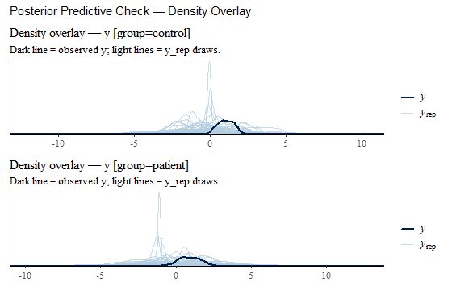
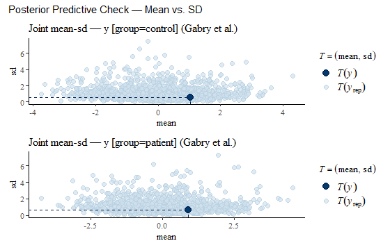
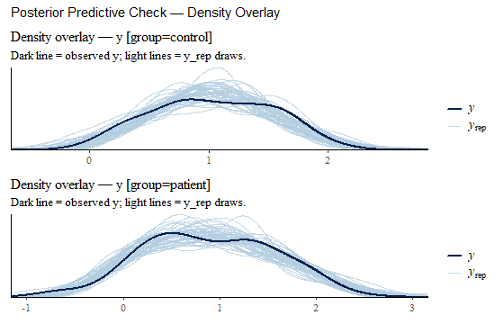
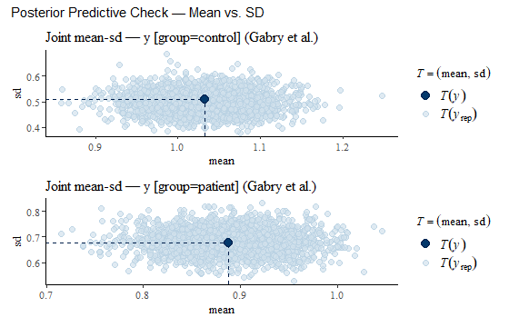
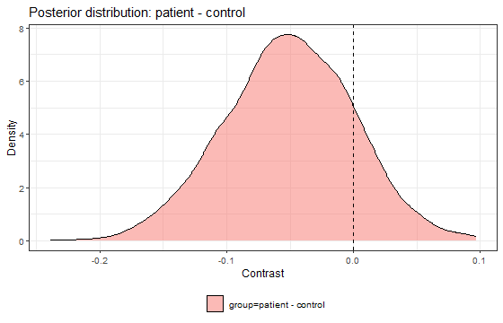
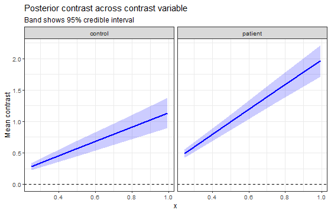
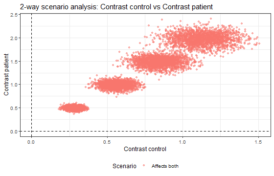
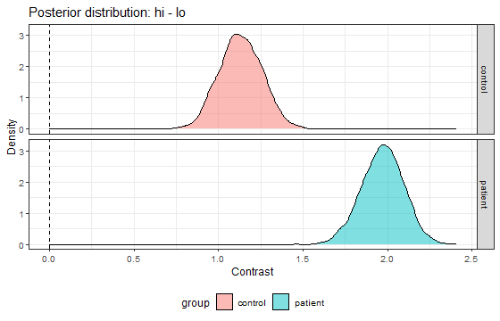

> This vignette was run with CmdStan on the maintainer's machine; its output is
> stored, so building it does not need Stan. The source is
> `vignettes/stanworkflow.Rmd.orig` (re-run with `data-raw/vignettes.R`).

stanworkflow takes a Stan model you wrote yourself and runs the usual Bayesian
workflow around it: compile, prior predictive check, fit, convergence
diagnostics, posterior predictive check and posterior contrasts. Each step
saves its result to disk, so an interrupted analysis resumes where it stopped.

This vignette walks through one analysis on simulated data.


``` r
library(stanworkflow)
```

## Data

A hundred patients and a hundred controls; the outcome `y` rises with a covariate `x`
(say, a standardised score), more steeply in patients.


``` r
set.seed(2026)
d <- data.frame(group = factor(rep(c("control", "patient"), each = 100),
                               levels = c("control", "patient")),
                x     = runif(200))
d$y <- ifelse(d$group == "control", 0.5 + 1.0 * d$x, 0.0 + 2.0 * d$x) + rnorm(200, sd = 0.4)
head(d)
#>     group          x         y
#> 1 control 0.69867347 1.6851801
#> 2 control 0.55653051 0.8589932
#> 3 control 0.14013996 0.5490261
#> 4 control 0.28572331 0.3410638
#> 5 control 0.55536901 1.4537022
#> 6 control 0.02513115 0.7498627
```

## The model folder

A model lives in a folder `models/<name>/` holding `model_code.stan` and
`priors.csv`. stanworkflow fills the Stan `data` block **by name** from the
data frame:

| Stan declaration | Filled with |
|---|---|
| `N` | `nrow(data)` |
| `n_<col>` | number of distinct values of `<col>` |
| `<col>_id` | `as.integer(factor(data$<col>))` (factor level order) |
| `<col>` | `data$<col>` |
| `prior_*` | the value in `priors.csv` |
| anything else | `data_list$extra` |

Every model declares `int<lower=0, upper=1> skip_likelihood` and gates its
likelihood on it, so the same code samples the prior predictive distribution.
The generated quantities hold `y_rep` (a replicate of the data, for predictive
checks) and `mu_rep` (the expected value, for contrasts; see
`vignette("contrasts")`).


``` r
model_code <- "
data {
  int<lower=1> N;
  int<lower=1> n_group;
  array[N] int<lower=1, upper=n_group> group_id;
  vector[N] x;
  vector[N] y;
  real<lower=0> prior_b_sd;
  int<lower=0, upper=1> skip_likelihood;
}
parameters {
  vector[n_group] a;
  vector[n_group] b;
  real<lower=0> sigma;
}
model {
  a ~ normal(0, 1);
  b ~ normal(0, prior_b_sd);
  sigma ~ exponential(1);
  if (!skip_likelihood) y ~ normal(a[group_id] + b[group_id] .* x, sigma);
}
generated quantities {
  vector[N] mu_rep = a[group_id] + b[group_id] .* x;
  array[N] real y_rep = normal_rng(mu_rep, sigma);
}
"
models <- file.path(tempdir(), "models")
dir.create(file.path(models, "lin"), recursive = TRUE, showWarnings = FALSE)
writeLines(model_code, file.path(models, "lin", "model_code.stan"))
write.csv(data.frame(prior = "prior_b_sd", value = 2),
          file.path(models, "lin", "priors.csv"), row.names = FALSE)
```

## Declare the analysis: `regimen()`

A `regimen` declares everything once: the model, the data, the contrasts to
report, where to save results and the sampler settings.


``` r
reg <- regimen(
  model_name    = "lin",
  data_list     = list(data = d),
  models_folder = models,
  results_path  = file.path(tempdir(), "results"),
  ppc_by        = "group",
  contrasts     = list(
    # patients minus controls, on the expected outcome, averaged over the data
    group = contrast("group", contrast_levels = c("control", "patient"),
                     outcome = outcome_spec(gq_var = "mu_rep")),
    # effect of moving x across its range, per group
    x     = contrast("x", continuous = TRUE, grouping_vars = "group",
                     outcome = outcome_spec(gq_var = "mu_rep"))
  ),
  draws_method  = "counterfactual",
  prior_sampler_params = list(iter_warmup = 300, iter_sampling = 300, refresh = 0,
                              show_messages = FALSE),
  post_sampler_params  = list(iter_warmup = 500, iter_sampling = 500, refresh = 0,
                              show_messages = FALSE, seed = 1)
)
reg
#> <regimen>
#>   model         : lin 
#>   models_folder : C:\Users\brain\AppData\Local\Temp\RtmpMnG4pu/models 
#>   results_path  : C:\Users\brain\AppData\Local\Temp\RtmpMnG4pu/results 
#>   outcome_var   : y 
#>   contrasts     : group, x 
#>   draws_method  : counterfactual 
#>   gq_steps      : 5 
#>   prob          : 0.95 
#> 
#>   Status:
#>     prepared : FALSE 
#>     tuned    : FALSE 
#>     fitted   : FALSE 
#>     inferred : FALSE
```

## Run it

`run()` executes the steps you ask for: `prepare` (compile and attach data),
`tune` (prior predictive), `fit` (posterior, posterior predictive checks,
diagnostics) and `infer` (the contrasts). Each step writes a checkpoint to
`results_path`.


``` r
reg <- run(reg, steps = c("prepare", "tune", "fit", "infer"))
```



`run()` reports as it goes (CmdStan progress, predictive-check tables and
plots; the text is hidden here). The plots above are, in order, the prior
predictive check (`tune`) and the posterior predictive check (`fit`), each as
density overlays and a mean-SD scatter per `ppc_by` group. Under the priors
alone, simulated data should cover the observed data without being absurd; if
not, edit `priors.csv` and run `tune` again. `fit()` warns that the model is
not marked as tuned until you accept the priors with `set_as_tuned()`; the
warning is hidden here.

The predictive checks are stored with numeric summaries: Bayesian p-values of
summary statistics and the coverage of the 50% and 90% predictive intervals,
per group.


``` r
reg$wf$posterior_ppc_results$y$summary
#>      ...1 p_B_mean p_B_sd p_B_median p_B_mad p_B_min p_B_max cov_50. cov_90.
#> 1 control   0.4965 0.4000     0.3905  0.1695  0.3575  0.6800    0.45    0.90
#> 2 patient   0.4955 0.5485     0.5200  0.5020  0.8455  0.6165    0.53    0.91
```

`regimen` keeps the underlying objects: `reg$wf` is the `wflow` (one model's
lifecycle), and `reg$wf$post_fit` is the fitted `stanmodel`, which carries the
draws.


``` r
reg$wf$diagnostics
#> # A tibble: 205 × 10
#>    variable    mean median     sd    mad      q5   q95  rhat ess_bulk ess_tail
#>    <chr>      <dbl>  <dbl>  <dbl>  <dbl>   <dbl> <dbl> <dbl>    <dbl>    <dbl>
#>  1 a[1]      0.481  0.480  0.0717 0.0731  0.362  0.599 1.00     1259.    1060.
#>  2 a[2]      0.0452 0.0447 0.0638 0.0622 -0.0572 0.149 1.00     1261.    1315.
#>  3 b[1]      1.14   1.14   0.127  0.128   0.937  1.35  1.00     1216.    1160.
#>  4 b[2]      1.99   1.99   0.126  0.124   1.77   2.18  1.01     1346.    1322.
#>  5 sigma     0.370  0.370  0.0185 0.0183  0.341  0.402 1.000    1813.    1040.
#>  6 mu_rep[1] 1.28   1.28   0.0466 0.0450  1.20   1.36  1.00     2220.    1727.
#>  7 mu_rep[2] 1.12   1.12   0.0386 0.0382  1.05   1.18  1.00     2672.    1488.
#>  8 mu_rep[3] 0.641  0.640  0.0572 0.0576  0.545  0.734 1.00     1347.    1208.
#>  9 mu_rep[4] 0.807  0.807  0.0449 0.0452  0.733  0.881 1.00     1614.    1418.
#> 10 mu_rep[5] 1.11   1.11   0.0386 0.0382  1.05   1.18  1.00     2673.    1488.
#> # ℹ 195 more rows
```

## Results


``` r
reg$status
#> $prepared
#> [1] TRUE
#> 
#> $tuned
#> [1] TRUE
#> 
#> $fitted
#> [1] TRUE
#> 
#> $inferred
#> [1] TRUE
get_inference(reg, "group")
#> 
#> <inference>
#>   Type:  1-way 
#>   Contrast variable: group 
#>   Grouping vars: <none> 
#>   Method:  counterfactual (categorical) 
#> 
#> Summary:
#> # A tibble: 1 × 4
#>   contrast_label             mean     lo     hi
#>   <chr>                     <dbl>  <dbl>  <dbl>
#> 1 group=patient - control -0.0510 -0.152 0.0480
#> 
#> Generating 1-way contrast plot...
```



``` r
get_inference(reg, "x")
#> 
#> <inference>
#>   Type:  1-way 
#>   Contrast variable: x 
#>   Grouping vars: group 
#>   Counterfactual grid sweep (continuous)
#>   Grid points: 4 
#> 
#> Grid Summary:
#> # A tibble: 8 × 8
#>   contrast_var_value baseline_var_value group    mean    lo    hi P_positive
#>                <dbl>              <dbl> <fct>   <dbl> <dbl> <dbl>      <dbl>
#> 1              0.249            0.00120 control 0.283 0.223 0.343          1
#> 2              0.249            0.00120 patient 0.493 0.429 0.553          1
#> 3              0.497            0.00120 control 0.566 0.446 0.687          1
#> 4              0.497            0.00120 patient 0.985 0.859 1.11           1
#> 5              0.744            0.00120 control 0.848 0.669 1.03           1
#> 6              0.744            0.00120 patient 1.48  1.29  1.66           1
#> 7              0.992            0.00120 control 1.13  0.892 1.37           1
#> 8              0.992            0.00120 patient 1.97  1.72  2.21           1
#> # ℹ 1 more variable: P_negative <dbl>
#> 
#> Generating counterfactual grid plot...
```



The group contrast is the patient-minus-control difference in the expected
outcome, averaged over the observed `x` values; the `x` contrast is the change
in the expected outcome from the lowest to the highest observed `x`, per group
(the simulated truths are 1.0 and 2.0).

## Resuming

The checkpoints live in `results_path`:


``` r
basename(unlist(reg$paths))
#> [1] "lin_prior.rds"     "lin_post.rds"      "lin_inference.rds"
```

After a crash or in a new session, `resume()` checks which files exist and
runs only what is missing. To add a contrast later, `update_contrasts()` resets
only the inference step, and `infer` reloads the fitted posterior from disk
instead of refitting:


``` r
reg <- update_contrasts(reg, list(
  both = contrast("x", continuous = TRUE, two_way = "group",
                  outcome = outcome_spec(gq_var = "mu_rep"))))
reg <- run(reg, steps = "infer")
```


``` r
get_inference(reg, "both")
#> 
#> <inference>
#>   Type:  2-way (scenarios) 
#>   Contrast variable: x 
#>   Grouping vars: <none> 
#>   Two-way outcome: group 
#>   Outcome levels: control / patient 
#> 
#> Scenario Probabilities:
#> # A tibble: 4 × 3
#>   contrast_var_value scenario     probability
#>                <dbl> <chr>              <dbl>
#> 1              0.249 Affects both           1
#> 2              0.497 Affects both           1
#> 3              0.744 Affects both           1
#> 4              0.992 Affects both           1
#> 
#> Generating 2-way scenario plot...
```



A `two_way` contrast classifies each posterior draw by the sign of the effect
in both groups ("affects both", "affects one only", "affects neither") and
reports the share of draws in each scenario.

For a model that is linear in `x`, the same slope can be read straight from the
parameter draws, without any `generate_quantities()` call:


``` r
infer_contrasts(reg$wf$post_fit,
                contrast("x", continuous = TRUE, parameter = "b",
                         factors = "group", delta = "range"),
                draws_method = "parameter")
#> 
#> <inference>
#>   Type:  1-way 
#>   Contrast variable: x 
#>   Grouping vars: group 
#>   Parameter: b 
#>   Scale: parameter × Δ(range of x) 
#> 
#> Parameter by level:
#> # A tibble: 2 × 7
#>   group   median hpdi_lo hpdi_hi    pd P_positive scale                    
#>   <fct>    <dbl>   <dbl>   <dbl> <dbl>      <dbl> <chr>                    
#> 1 control   1.13   0.894    1.37     1          1 parameter × Δ(range of x)
#> 2 patient   1.97   1.70     2.19     1          1 parameter × Δ(range of x)
#>   Method:  parameter 
#> 
#> Summary:
#> # A tibble: 2 × 9
#>   contrast_label group   median hpdi_lo hpdi_hi    pd P_positive  prob scale    
#>   <chr>          <fct>    <dbl>   <dbl>   <dbl> <dbl>      <dbl> <dbl> <chr>    
#> 1 b              control   1.13   0.894    1.37     1          1  0.95 paramete…
#> 2 b              patient   1.97   1.70     2.19     1          1  0.95 paramete…
#> 
#> Generating 1-way contrast plot...
```



`b` scaled to the range of `x` equals the counterfactual `x` contrast above,
draw by draw. `vignette("contrasts")` explains when the routes agree and when
they do not.

## Lower-level layers

`regimen` sits on two layers you can also use directly:

- `wflow()` — one model's lifecycle (`attach_data()`, `tune()`,
  `fit_posterior()`, `run_diagnostics()`, `run_inference()`).
- `stanmodel()` — a thin `cmdstanr` wrapper (`compile_from_file()`,
  `get_stan_data()`, `fit()`, `gq()`, `ppc()`, `diagnose()`), and
  `infer_contrasts()` on a fitted `stanmodel`.


``` r
m <- stanmodel() |> compile_from_file(file.path(models, "lin", "model_code.stan"))
m$priors$prior_b_sd <- 2
m <- fit(m, data = d)
infer_contrasts(m, contrast("group", contrast_levels = c("control", "patient"),
                            outcome = outcome_spec(gq_var = "mu_rep")),
                draws_method = "counterfactual")
```
